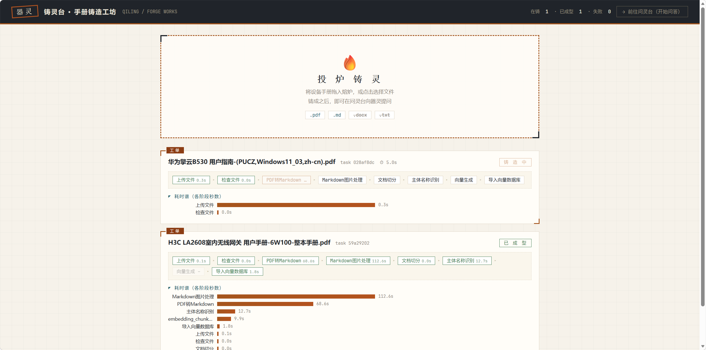
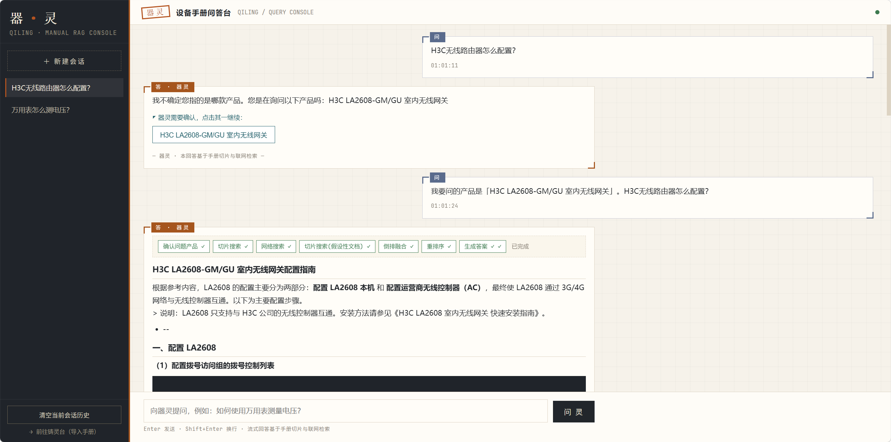

# 器灵 QiLing · 企业设备手册多模态 RAG 智能问答系统

> 把设备手册"投炉"铸成可问答的知识灵体：上传 PDF/Markdown 手册，自动完成解析、图片摘要、向量入库；提问时经商品名对齐闸门路由至多路检索，以 SSE 流式返回带图表引用的答案。

`Python` `LangGraph` `Milvus` `BGE-M3` `FastAPI` `SSE` `MinIO` `MongoDB`

---

## 项目简介

面向企业设备手册场景的多模态 RAG 问答系统，采用**双工作台**设计：

| 工作台 | 页面 | 职责 |
|---|---|---|
| **问灵台** | `knowledge/front/qiling.html` | 多会话问答：流水线进度可视化、流式回答、图片墙与灯箱、澄清候选交互 |
| **铸灵台** | `knowledge/front/forge.html` | 手册导入：拖拽投炉、多文件队列、阶段轨 + 每节点耗时谱 |

## 功能特性

- **导入管线全流程可视化**：每个节点的运行状态与独立耗时（秒）实时展示，最慢环节一目了然
- **节点级进度流式推送**：SSE `progress` 事件驱动，前端实时渲染管线 chips
- **逐字流式回答**：LLM 输出经 `delta` 事件打字机式渲染，支持 Markdown（标题/列表/代码块）
- **多模态答案**：自动收集切片中的图片引用，出口统一归一化 URL（空格编码、前缀修复、装饰性小图标过滤），前端渲染图片墙 + 点击灯箱
- **澄清式防幻觉**：商品名对不上时拦截提问、反问候选（可点击芯片自动回填），而非带着错误过滤条件硬检索
- **多会话管理**：会话侧栏 + MongoDB 历史持久化，刷新/切换会话完整还原上下文

## 架构

```
═══════════ 导入服务 :8000（铸灵台 /front/forge.html）═══════════
PDF/Markdown ─▶ 检查文件 → PDF转Markdown(MinerU) → 图片处理(VLM摘要+MinIO)
                    → 文档切分 → 主体名称识别 → BGE-M3稠密+稀疏向量 → Milvus
                POST /upload · GET /status/{task_id}(轮询1.5s)

═══════════ 查询服务 :8001（问灵台 /front/qiling.html）═══════════
用户提问 ─▶ 商品名提取(LLM) ─▶ 对齐闸门 ─┬─ confirmed ─▶ 继续检索
                                        ├─ options   ─▶ 反问候选(拦截)
                                        └─ 无匹配    ─▶ 致歉并引导
confirmed ─▶ 三路召回（混合检索 + HyDE + 联网MCP）─▶ RRF融合 ─▶ Reranker精排
            ─▶ LLM流式生成 ══SSE(progress/delta/final)══▶ 前端渲染
                POST /query · GET /stream/{task_id} · GET/DELETE /history/{session_id}
```

**SSE 生产者-消费者模型**：后台线程运行 LangGraph 管线生产事件 → `queue.Queue` 按 `task_id` 缓冲 → 事件循环协程消费并打包为 SSE 帧 → `StreamingResponse` 推送。生产与消费节奏解耦，前端晚连不丢事件。

## 技术亮点（个人实现与调试）

- **查询管线节点层**：商品名提取、对齐闸门、三路检索、RRF 融合、精排、流式生成均实现
- **动态 top_k**：Reranker 分数 sigmoid 归一化后按最大落差自适应截断，替代固定 top_k（平坦批次不产生假断崖）
- **修复 LangGraph 并行写冲突**：并行分支对同一 state 键的全量返回导致 `InvalidUpdateError`，改为增量返回

## 快速开始

### 1. 前置依赖

- Milvus（standalone）、MinIO、MongoDB
- Python 3.11+

### 2. 配置环境变量

```bash
cp .env.example .env   # 填入 LLM/VLM/MinerU/阿里云MCP 的密钥与各存储地址
```

### 3. 启动两个服务

```bash
# 终端1：导入服务（铸灵台）
python -m knowledge.api.import_router       # http://localhost:8000/front/forge.html

# 终端2：查询服务（问灵台）
python -m knowledge.api.query_router        # http://localhost:8001/front/qiling.html
```

### 4. 使用流程

1. 在**铸灵台**拖入设备手册（`.pdf` / `.md`），等待"已成型"
2. 在**问灵台**提问，例如："H3C LA2608室内无线网关如何安装SIM卡？"
3. 观察流水线进度 → 流式回答 → 图片墙；追问会自动利用历史上下文做指代消解

## 项目结构

```
knowledge/
├── api/                  # FastAPI 路由（import_router :8000 / query_router :8001）
├── core/                 # 依赖注入、路径
├── front/                # 原生前端（qiling.html 问灵台 / forge.html 铸灵台）
├── processor/
│   ├── import_processor/ # 导入管线节点
│   └── query_processor/  # 查询管线节点（核心，独立实现）
├── prompts/              # 提示词模板
├── schema/               # Pydantic 请求/响应模型
├── service/              # 业务服务层
└── utils/                # SSE 队列、任务状态、存储/模型客户端
```

## 界面截图

**铸灵台(文档上传知识库界面)**



**问灵台(提问界面)**



## 说明

个人学习实践项目：核心查询管线节点层为独立实现与调试；导入管线与部分工具层参考了课程实战项目的结构设计。项目仅用于技术学习与演示，不用于生产环境。

## License

[MIT](LICENSE)
